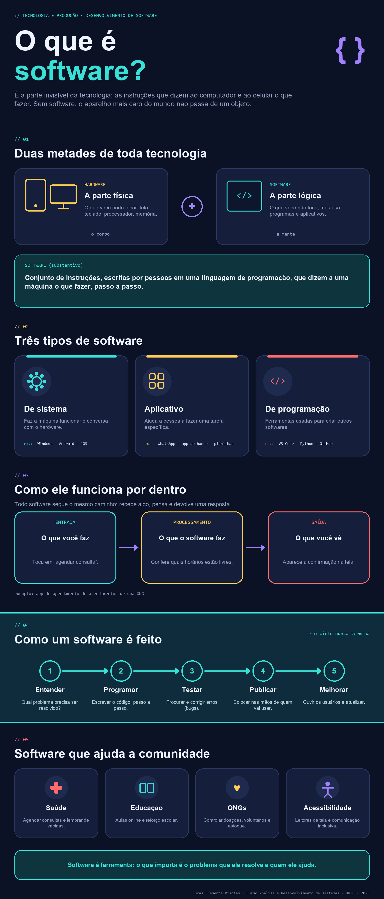

<p align="center">
  
</p>

---

## O que é Software? — Infográfico Educativo


Este projeto consiste na elaboração de um infográfico educativo com o tema "O que é Software?", desenvolvido com o objetivo de explicar de maneira visual, simples e acessível os conceitos fundamentais relacionados ao funcionamento dos softwares e sua importância na sociedade.

O material apresenta a diferença entre hardware e software, os principais tipos de software (sistemas, aplicativos e ferramentas de programação), além de demonstrar como um software recebe informações, realiza processamentos e apresenta resultados ao usuário.

Também são abordadas as etapas de desenvolvimento de um software, desde a identificação de um problema até a publicação e melhoria contínua, destacando aplicações práticas em áreas como saúde, educação, organizações não governamentais e acessibilidade.

## 🎯 Objetivo

Objetivos

Explicar o conceito de software e sua relação com o hardware.

Identificar os principais tipos de software e suas finalidades.

Demonstrar de forma simplificada o funcionamento de um programa.

Apresentar as etapas básicas do desenvolvimento de software.

Evidenciar como soluções tecnológicas podem contribuir para a comunidade.

## Conteúdo abordado

1 - Hardware e software: diferenças e complementaridade.

2 - Tipos de software: sistema, aplicativo e programação.

3 - Funcionamento interno: entrada, processamento e saída.

4 - Ciclo de desenvolvimento: entender, programar, testar, publicar e melhorar.

5 - Aplicações sociais e benefícios para a comunidade.

### ✏️ Personalização

No topo do arquivo `gerar_infografico.py`, edite a variável `CREDITO` com seu nome, curso e instituição. Textos, cores e seções também podem ser alterados diretamente no código.

## 📁 Estrutura do repositório

```
.
├── gerar_infografico.py      # Script que desenha o infográfico
├── infografico_software.png  # Imagem final gerada
└── README.md
```

## 👤 Autor

**Lucas Presente Virosta**
Curso de Análise e desenvolvimento de sistemas · UNIP
